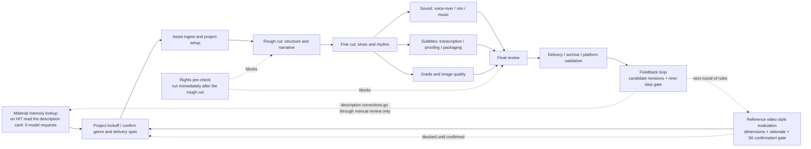

# Knowledge map: a full-chain index from raw footage to delivery

> Category: Overview | Topic: how the capability domains relate, the end-to-end workflow and reverse lookup by task | Compiled: 2026-11-10 | Applies to: working out which documents to read when starting a project; the section routing table used when building a video-editing skill

---

## 1. Capability domain structure

The library is organised around one arc: **remember the footage → understand the reference → make the film → express it clearly → get it published → check it rigorously → keep evolving**.

| Layer | Directory | Questions it answers | Documents |
| --- | --- | --- | --- |
| Creative | `01-editing-craft` | Why shots cut together the way they do, how to hold the pace, how to keep a project clean, how to keep colour consistent | 4 |
| Creative | `04-genre-playbooks` | How structure and parameters change for a different kind of film | 6 |
| Expression | `02-audio-and-voice` | How to record sound, mix it, score it, and use AI voice | 4 |
| Expression | `03-subtitles` | Subtitle conventions, formats, toolchains, multilingual work and accessibility | 4 |
| Constraints | `05-copyright` | Whether this asset can be used, and what happens if it is | 5 |
| Gate | `06-delivery-qc` | Item-by-item inspection before delivery, and who signs it off | 3 + 1 script |
| Support | `07-tools-and-resources` | Which software to use, where footage comes from, where to keep learning | 2 |
| **Evolution** | **`08-rsi`** | **How to evaluate a trending reference video dimension by dimension with stated reasoning, and how to turn experience into rules** | **6 + 3 templates + 1 script + 2 README** |
| **Memory** | **`09-material-memory`** | **Analyse a piece of footage once — what it says, where it was shot, what it looks like — then reuse it across topics without calling the model again** | **4 + 4 templates + 1 tool + 2 README** |
| Navigation | `../INDEX.md` + `00-overview` | Task routing, capability domain mapping, source reliability, file inventory | 4 |

Three cross-cutting themes run through every directory: **actionable parameters** (each conclusion carries a number and a command wherever possible), **authorisation and compliance** (any external asset triggers 05 and 06), and **auditability** (every factual conclusion carries a source URL, and anything uncertain is marked TO VERIFY). Volume `08` adds two more: **mandatory rationale** (a judgement with no reasoning is discarded) and the **user confirmation gate** (no cutting starts until an evaluation has been confirmed). Volume `09` adds another two: **read-only on a hit** (a cache hit means no further video-model request) and **topic neutrality** (the material description and its topical use sit in separate layers).

---

## 2. End-to-end workflow and document routing

> With no reference video, start at `A`. With one, `K` is a **mandatory precondition**. Either way `M` comes first: know what footage you hold before settling style and structure.

| Stage | Primary document | Supporting |
| --- | --- | --- |
| **Material memory and analysis** | `09-material-memory/README.md` P0 protocol + `scripts/material_cache.py lookup` | Only on a miss, run one full analysis with `09-material-memory/templates/model-analysis-prompt.md`; `09/01` fields and V1–V8 |
| **Multi-topic reuse** | `09-material-memory/03` + `use` / `themes` / `stats` | Topic adaptation layer kept separate from the MDC; rights re-checked for each topic |
| **Style reference and evaluation** | `08-rsi/02` + `08-rsi/templates/reference-video-evaluation.md` | `scripts/reference_probe.sh`; `scripts/keyframe_diff.py extract` for the per-shot baseline; `08/03` fingerprint; **S6 user confirmation gate** |
| Project kickoff | `04-genre-playbooks/0X` (pick the matching genre, read its metrics and structure template) | `01-editing-craft/03` project standards |
| Assets and project setup | `01-editing-craft/03-editing-workflow-and-project-standards.md` | `07-tools-and-resources/02` asset licensing; `09/01` `edit_notes` |
| Rough cut / fine cut | `01-editing-craft/01`, `02` | `04-genre-playbooks/0X` beat sheet; `08/04` mapping scheme |
| Sound | `02-audio-and-voice/01`→`02`→`03` (`04` if using AI) | `06-delivery-qc/01` loudness conventions |
| Subtitles | `03-subtitles/01`→`02`→`03` (`04` for multilingual or accessibility work) | `06-delivery-qc/03` Table E; `09/01` `onscreen_text` |
| Grading | `01-editing-craft/04-color-grading-and-image-quality.md` | `06-delivery-qc/01` colour-tagging check |
| **Rights pre-check** | `05-copyright/02`, `03`, `04` | `08/01` §6, how far a style may be borrowed; `06/02` Table C ledger; `09/01` `rights_status` |
| Final review | `06-delivery-qc/01` + `02` + `03` | `qc_scan.sh` scans the film automatically; `08/07` keyframe diff against the reference; `08/04` §6 L4 deviation comparison; `09` `verify` |
| Delivery | `06-delivery-qc/03` archive checklist | `01-editing-craft/03` backup standards |
| **Feedback and evolution** | `08-rsi/05` + `08-rsi/templates/self-improvement-record.md` | `08/06` version governance; `09/04` new meta-metrics and guardrail 8 |

---

## 3. Reverse lookup by task

| What I want to do… | Go straight to |
| --- | --- |
| **Analyse and adopt a piece of footage without burning tokens twice** | **`09-material-memory/README.md` P0 protocol → `material_cache.py lookup`; on a HIT, read the card** |
| **Use one asset for several topics** | `09/03` L2 adaptation layer + `use` / `themes` / `stats` |
| **What to ask the model the first time an asset is analysed** | `09-material-memory/templates/model-analysis-prompt.md` (all five groups in one pass, fields aligned to `mdc-v1`) |
| **Write a material description card** | `09/01` field dictionary and V1–V8 + `09-material-memory/templates/material-description-card.yaml` |
| **The asset has been re-versioned — is the cache still valid** | `09/02` invalidation table + `material_cache.py verify --full` |
| **Cut in the style of a hit video** | **`08-rsi/README.md` P0 protocol → run the probe script, fill in the evaluation sheet, state the reasoning, clear the S6 confirmation, and only then start cutting** |
| **Evaluate a video's editing technique / sound design / scene** | `08/02` three dimensions, 10 sub-items each + `08-rsi/templates/reference-video-evaluation.md` |
| Decide whether two shots can cut together | The 180°, 30° and match-cut passages in `01/01` |
| Keep an interview from dragging | J/L-cuts and the shot-duration table in `01/02`; B-roll and jump cuts in `04/02` |
| Beat sync keeps missing | Beats and frame-level precision in `01/02`; bars and BPM in `02/03` |
| The client says "the sound keeps going up and down" | Loudness standards and loudnorm in `02/02`; the ebur128 measurement in `06/01` |
| Should subtitles be burned into the picture | Soft versus burned-in in `03/02`; muxing and burn-in commands in `03/03` |
| Make a 15-second ad | Multi-version cutdown template in `04/03`; ad-copy risk in `05/…`; Table D in `06/02` |
| I used a clip from a film or TV series | Derivative-work decision tree in `05/02` (**read this first**), then the statutory text in `05/01` |
| Can I copy the music or kinetic type from the reference | `08/01` §6 + dimension G in `08/02` — **no**; migrate the parameters only |
| Find free music | Stock library list in `07/02` → then check the three layers of rights in `05/03` |
| Clone someone's voice with AI | Workflow in `02/04` → **voice rights and consent in `05/04`** → AI labelling in `06/02` |
| The last day before delivery | `06/03` from Table A through Table G; run `qc_scan.sh` once; `09` `verify` |
| Publish overseas | `05/05` platform rules, DMCA / Content ID, DSM Article 17 |
| Make the system "get more accurate with use" without drifting | Nine-step gate and drift control in `08/05`; kill switch and rollback in `08/06`; guardrail 8 in `09/04` |
| Write automation or probe scripts | `07/01` software and the ffmpeg ecosystem; `scripts/qc_scan.sh`, `scripts/reference_probe.sh`, `scripts/material_cache.py` |

---

## 4. One-page parameter quick reference: the values called most often

> Every value here is a **starting suggestion**, not a mandatory standard; where they conflict, the specific document, the target platform's current official documentation and the delivery sheet take precedence. Values marked `*` rest on sources that disagree — see the TO VERIFY section of the relevant document.

| Domain | Parameter | Common value |
| --- | --- | --- |
| Editing | 180° line / 30° rule | Camera on the same side of the line; ≥30° of angle change on the same subject, or a clear change of shot size |
| Editing | Action cut point | 1–2 frames before the peak of the action |
| Editing | J-cut / L-cut offset | 8–24 frames * |
| Editing | B-roll handles at the seam | ≥12 frames on each side * |
| Production | Timecode / audio specification | Projects commonly start at `01:00:00:00` *; 48 kHz / 24-bit |
| Grading | SDR colour | Rec.709 / BT.1886; the flag must be written into the container |
| Grading | HDR | Rec.2020 + HLG or PQ (BT.2100) |
| Audio | Broadcast loudness (Europe) | −23 LUFS ±1, True Peak ≤ −1 dBTP (EBU R128) |
| Audio | Broadcast loudness (US) | −24 LKFS ±2, True Peak ≤ −2 dBTP (ATSC A/85) |
| Audio | Streaming | Roughly −14 to −16 LUFS, varying by platform * |
| Audio | Vocal band | 300–3400 Hz carries the core of intelligibility |
| Subtitles | Lines / characters | ≤2 lines; about 12–16 characters per Chinese line * |
| Subtitles | On-screen duration | About 1 s minimum, normally 1.5–6 s; reading speed 4–7 characters/s * |
| Subtitles | Frame rate and timecode | Match the finished frame rate; SRT uses comma plus milliseconds, WebVTT/ASS use a period |
| Frame | Landscape / portrait | 1920×1080 / 1080×1920 (9:16) |
| QC | Black / silence / freeze thresholds | `d=0.5:pix_th=0.10` / `−40dB:0.5s` / `−60dB:2s` |
| QC | A/V sync | A lip-sync error of ≤2 frames is perceptible |
| Compliance | Derivative works | Appropriate quotation + author and title attributed + no substantial substitution + no effect on normal use |
| Compliance | Music | Lyrics and composition, recording and performance are three separate layers of rights |
| **RSI** | **Mandatory rationale** | **Observation + evidence + inference + action + confidence; any missing element voids it** |
| **RSI** | Scene-cut threshold | `select scene > 0.25` * (fast pans and flashes produce false positives; cross-check) |
| **RSI** | Representative pace value | **Median** shot duration (do not use the mean on a long-tailed distribution) |
| **RSI** | Self-evolution parameters | η=0.05 / drift per round ≤0.1 / N_min=5 / 7-day cooldown * |
| **Memory** | **Read-only on a hit** | **`lookup` returns HIT → 0 video-model requests** |
| **Memory** | Video input token estimate | About 100 tok/s at low resolution, about 300 tok/s at high resolution (a further figure of 263 tok/s exists *) |
| **Memory** | Content hash | SHA-256 over a 6 MiB sample by default; `--full` hashes the whole file for delivery-grade work |
| **Memory** | Multi-topic saving | `1 − 1/N` (N is the number of topics; video input tokens only) |
| **Memory** | Card hard constraints | Topic-neutral / place names `null` without evidence / E1–E4 grading / V1–V8 validation |

---

## 5. Five tracks — do not follow only one

1. **Picture track** (01 → 04 → grading): decides whether it looks good, but does not guarantee it can ship.
2. **Sound and text track** (02 → 03): decides whether viewers understand it and hear it clearly — the main battleground for completion rate and accessibility.
3. **Risk track** (05 → 06): decides whether it can ship. This one must run **as early as the rough cut**, because swapping an asset after lock costs you the whole timeline.
4. **Evolution track** (08 → feedback → 08): decides whether the twentieth job is more accurate than the first. It depends on the first three tracks recording every prediction and every outcome honestly; otherwise self-evolution only amplifies noise.
5. **Memory track** (09 → the whole chain): decides whether the twentieth reuse of the same footage still costs another model call. It is also the **reproducible input snapshot** for the evolution track — without it, the "input" in a frozen regression set cannot be reconstructed at all.

Beginners most often fail not by cutting badly but by **remembering to check rights only on the last day**. More experienced editors most often fail by **copying how a reference expresses itself instead of its parameters**, by **changing the rules after a single hit**, and by **re-watching the footage for every topic**.

---

## 6. Maintenance rules

- Every document carries a metadata block at the top and "References" plus a retrieval date at the end; when you edit one, update `Compiled` in the same pass.
- Platform specifications, statutes, software pricing, AI service terms and token-billing conventions are **volatile information**; always re-check the current official text before citing.
- When you add a document, update the routing table in `../SKILL.md`, this file and `manifest.csv` together; a new **case record** only requires `08-rsi/case-library/README.md`; new **material cache** data is maintained by the volume `09` tooling itself and does not touch the index.
- After re-checking a TO VERIFY item, update `sources-and-reliability.md`; no TO VERIFY entry is ever deleted — append the conclusion and the date.
- In volume `08`, rule versions, audit logs and counter-examples are append-only; the global self-evolution switch is `evolution_enabled` in `case-library/_config.yaml`.
- In volume `09`, `usage.csv`, `audit.log` and historical card versions under `cache/` are append-only; the global cache switch is `cache_enabled` in `cache/_config.json`.

---

## References

This file is an index; every factual parameter is quoted from one of the volumes in this library, and the source URLs appear at the end of the corresponding document.
Retrieved: 2026-11-10.
