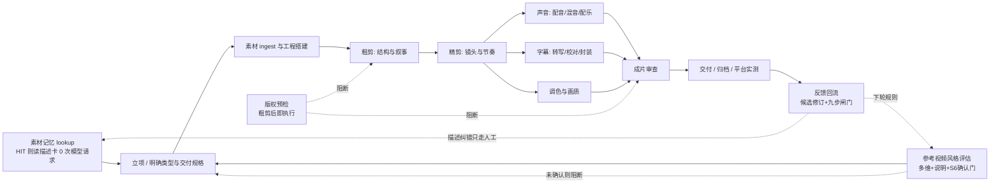

# 知识地图：从素材到交付的全链路索引

> 分类：总览 | 主题：能力域的关系、端到端工作流与按任务反查 | 整理日期：2026-11-10 | 适用：新建项目时定位该读哪几份资料；构建剪辑 skill 时的章节路由表

---

## 一、能力域结构

本知识库按「**记住素材 → 看懂参考 → 做片子 → 讲清楚 → 能发布 → 查得严 → 会进化**」组织：

| 层 | 目录 | 回答的问题 | 文档数 |
| --- | --- | --- | --- |
| 创作层 | `01-剪辑技巧` | 镜头为什么这样接、节奏怎么控、工程怎么不乱、颜色怎么统一 | 4 |
| 创作层 | `04-分类型剪辑` | 换一种片子，结构与参数该怎么改 | 6 |
| 表达层 | `02-配音与音频` | 声音怎么录、怎么混、怎么配、AI 配音怎么用 | 4 |
| 表达层 | `03-字幕系统` | 字幕规范、格式、工具流、多语言与无障碍 | 4 |
| 约束层 | `05-版权法规` | 这条素材能不能用、用了会不会出事 | 5 |
| 闸门层 | `06-成片审查` | 交付前逐项验货，谁签字放行 | 3 + 1 脚本 |
| 支撑层 | `07-工具与资源` | 用什么软件、素材从哪来、去哪继续学 | 2 |
| **进化层** | **`08-RSI自进化`** | **参考热门视频时怎么逐维评估并给说明、怎么把经验沉淀成规则** | **6 + 3 模板 + 1 脚本 + 2 README** |
| **记忆层** | **`09-素材记忆`** | **一段素材只看一次：讲了什么/在哪拍/什么风格，如何跨主题复用而不重复请求模型** | **4 + 4 模板 + 1 工具 + 2 README** |
| 导航层 | `../INDEX.md` + `00-总览` | 任务路由、能力域映射、来源可信度、文件清单 | 4 |

三个横切主题贯穿所有目录：**可操作参数**（每个结论尽量给数字与命令）、**授权与合规**（凡涉及外部素材即触发 05 与 06）、**可复核性**（凡事实性结论附来源 URL，不确定处标「待核实」）。`08` 卷另加两条：**说明强制**（没有说明的判断丢弃）与**用户确认门**（评估未确认不开剪）。`09` 卷另加两条：**命中即只读**（缓存命中不再请求视频模型）与**主题中立**（素材描述与主题用途分层）。

---

## 二、端到端工作流与文档路由

> 没有参考视频时，从 `A` 直接开始；有参考视频时，`K` 是**强制前置**。无论哪种，`M` 都在最前面：先知道手上有什么素材，再定风格与结构。

| 阶段 | 首选文档 | 配套 |
| --- | --- | --- |
| **素材记忆与分析** | `09-素材记忆/README.md` P0 协议 + `scripts/material_cache.py lookup` | 未命中才用 `09-素材记忆/模板/模型分析提示词.md` 做一次全量分析；`09/01` 字段与 V1–V8 |
| **多主题复用** | `09-素材记忆/03` + `use` / `themes` / `stats` | 主题适配层与 MDC 分离；授权逐主题复核 |
| **风格参考与评估** | `08-RSI自进化/02` + `08-RSI自进化/模板/参考视频评估表.md` | `scripts/reference_probe.sh`；`08/03` 指纹；**S6 用户确认门** |
| 立项 | `04-分类型剪辑/0X`（选对应类型，读指标与结构模板） | `01-剪辑技巧/03` 工程规范 |
| 素材与工程 | `01-剪辑技巧/03-剪辑工作流与工程规范.md` | `07-工具与资源/02` 素材授权；`09/01` `edit_notes` |
| 粗剪/精剪 | `01-剪辑技巧/01`、`02` | `04-分类型剪辑/0X` 节拍表；`08/04` 映射方案 |
| 声音 | `02-配音与音频/01`→`02`→`03`（`04` 若用 AI） | `06-成片审查/01` 响度口径 |
| 字幕 | `03-字幕系统/01`→`02`→`03`（`04` 若多语言/无障碍） | `06-成片审查/03` 表 E；`09/01` `onscreen_text` |
| 调色 | `01-剪辑技巧/04-调色与画质处理.md` | `06-成片审查/01` 色彩标记核对 |
| **版权预检** | `05-版权法规/02`、`03`、`04` | `08/01` §六 风格可借鉴边界；`06/02` 表 C 台账；`09/01` `rights_status` |
| 终审 | `06-成片审查/01` + `02` + `03` | `qc_scan.sh` 自动扫片；`08/04` §六 L4 偏差比对；`09` `verify` |
| 交付 | `06-成片审查/03` 归档清单 | `01-剪辑技巧/03` 备份规范 |
| **反馈与进化** | `08-RSI自进化/05` + `08-RSI自进化/模板/自进化记录模板.md` | `08/06` 版本治理；`09/04` 新元指标与第 8 条护栏 |

---

## 三、按任务反查

| 我现在要…… | 直接翻 |
| --- | --- |
| **分析/采用一段视频素材，别重复花 token** | **`09-素材记忆/README.md` P0 协议 → `material_cache.py lookup`，HIT 即直接读卡** |
| **同一素材给好几个主题用** | `09/03` L2 适配层 + `use` / `themes` / `stats` |
| **第一次分析素材时该问模型什么** | `09-素材记忆/模板/模型分析提示词.md`（一次问全五组，字段对齐 `mdc-v1`） |
| **写一张素材描述卡** | `09/01` 字段字典与 V1–V8 + `09/模板/素材描述卡模板.yaml` |
| **素材改过版本，缓存还对不对** | `09/02` 失效条件表 + `material_cache.py verify --full` |
| **参考某条爆款视频的风格来剪** | **`08-RSI自进化/README.md` P0 协议 → 先跑探测脚本、填评估表、给说明、S6 确认后才开剪** |
| **评估一个视频的剪辑手法/音效/场景** | `08/02` 三大维度各 10 子项 + `08-RSI自进化/模板/参考视频评估表.md` |
| 判断两个镜头能不能接 | `01/01` 的 180°、30°、匹配剪辑段 |
| 让一段访谈不闷 | `01/02` 的 J/L-cut 与镜头时长表；`04/02` 的 B-roll 与跳切 |
| 卡点卡不准 | `01/02` 节拍与帧级精度；`02/03` 小节与 BPM |
| 客户说「声音忽大忽小」 | `02/02` 响度标准与 loudnorm；`06/01` 的 ebur128 实测 |
| 字幕要不要压进画面 | `03/02` 软字幕 vs 硬烧；`03/03` 封装与烧录命令 |
| 做一个 15 秒广告 | `04/03` 多版本套剪模板；`05/…` 广告用语风险；`06/02` 表 D |
| 用了一段影视剧片段 | `05/02` 二创决策树（**先看这个**），再 `05/01` 法条原文 |
| 参考片的音乐/花字能不能照搬 | `08/01` §六 + `08/02` 维度 G——**不能**，只迁移参数 |
| 找免费音乐 | `07/02` 素材库清单 → 再回 `05/03` 核对三层权利 |
| 用 AI 克隆某人的声音 | `02/04` 工作流 → **`05/04` 声音权与同意** → `06/02` AI 标识 |
| 交付前最后一天 | `06/03` 从表 A 填到表 G；`qc_scan.sh` 先跑一遍；`09` `verify` |
| 发到海外 | `05/05` 平台规则、DMCA/Content ID、DSM 第 17 条 |
| 让系统「越用越准」而不跑偏 | `08/05` 九步闸门与防漂移；`08/06` kill switch 与回滚；`09/04` 第 8 条护栏 |
| 写自动化剪辑/探测脚本 | `07/01` 软件与 ffmpeg 生态；`scripts/qc_scan.sh`、`scripts/reference_probe.sh`、`scripts/material_cache.py` |

---

## 四、一页速查：最常被调用的参数

> 均为**起始建议值**，非强制标准；冲突时以对应文档、目标平台最新官方文档与交付单为准。带 `*` 的来源口径存在分歧，详见各文档「待核实」段。

| 域 | 参数 | 常用值 |
| --- | --- | --- |
| 剪辑 | 180° 轴线 / 30° 法则 | 机位同侧；同主体角度差 ≥30° 或景别显著改变 |
| 剪辑 | 动作切点 | 动作峰值前 1–2 帧 |
| 剪辑 | J-cut / L-cut 偏移 | 8–24 帧 * |
| 剪辑 | B-roll 接缝 handles | 两侧各 ≥12 帧 * |
| 制作 | 时间码 / 音频规格 | 工程常以 `01:00:00:00` 起 *；48 kHz / 24-bit |
| 调色 | SDR 色彩 | Rec.709 / BT.1886；标记须写入容器 |
| 调色 | HDR | Rec.2020 + HLG 或 PQ（BT.2100） |
| 音频 | 广播响度（欧） | −23 LUFS ±1，True Peak ≤ −1 dBTP（EBU R128） |
| 音频 | 广播响度（美） | −24 LKFS ±2，True Peak ≤ −2 dBTP（ATSC A/85） |
| 音频 | 流媒体 | 约 −14 ~ −16 LUFS，各平台不同 * |
| 音频 | 人声频段 | 300–3400 Hz 为可懂度核心 |
| 字幕 | 行数 / 字数 | ≤2 行；中文单行约 12–16 字 * |
| 字幕 | 停留时长 | 最短约 1 s，常规 1.5–6 s；阅读速度 4–7 字/秒 * |
| 字幕 | 帧率与时间码 | 与成片帧率一致；SRT 用逗号毫秒，WebVTT/ASS 用点 |
| 画幅 | 横屏 / 竖屏 | 1920×1080 / 1080×1920（9:16） |
| QC | 黑场 / 静音 / 冻帧阈值 | `d=0.5:pix_th=0.10` / `−40dB:0.5s` / `−60dB:2s` |
| QC | 音画同步 | 口型偏差 ≤2 帧可感知 |
| 合规 | 二创 | 适当引用 + 指明作者与作品名 + 不实质替代 + 不影响正常使用 |
| 合规 | 音乐 | 词曲 / 录音 / 表演三层权利分别覆盖 |
| **RSI** | **说明强制** | **观察 + 依据 + 推断 + 动作项 + 置信度，缺一作废** |
| **RSI** | 场景切点阈值 | `select scene > 0.25` *（快速摇镜/闪光会误报，须交叉验证） |
| **RSI** | 节奏代表值 | 镜头时长**中位数**（长尾分布下不用均值） |
| **RSI** | 自进化参数 | η=0.05 / 单轮漂移 ≤0.1 / N_min=5 / 冷却 7 天 * |
| **记忆** | **命中即只读** | **`lookup` 返回 HIT → 0 次视频模型请求** |
| **记忆** | 视频输入 token 估算 | 低分辨率约 100 tok/s、高分辨率约 300 tok/s（另有 263 tok/s 口径 *） |
| **记忆** | 内容哈希 | 默认 6 MiB 采样 SHA-256；交付级用 `--full` 全文件哈希 |
| **记忆** | 多主题节省比例 | `1 − 1/N`（N 为主题数，只计视频输入 token） |
| **记忆** | 卡片硬约束 | 主题中立 / 地名无凭证填 `null` / E1–E4 分级 / V1–V8 校验 |

---

## 五、五条主线，别只走一条

1. **画面线**（01 → 04 → 调色）：决定「好不好看」，但不保证能发。
2. **声音与文字线**（02 → 03）：决定「看不看得懂、听不听得清」，是完播率与可访问性的主战场。
3. **风险线**（05 → 06）：决定「能不能发」。这条线必须**前置到粗剪**，因为定稿后再换素材，代价是重做整条时间线。
4. **进化线**（08 → 反馈 → 08）：决定「第 20 次任务是否比第 1 次准」。前提是前三条线已经把每次的预测与结果如实留痕，否则自进化只会把噪声放大。
5. **记忆线**（09 → 全链路）：决定「同一段素材第 20 次被采用时，是不是还要再花一次模型钱」。它同时是进化线的**可复现输入快照**——没有它，冻结回归集里的「输入」根本无法重建。

新手最常见的失败不是剪得不好，而是**只在最后一天才想起来查授权**；进阶用户最常见的失败是**模仿了参考片的表达而非参数**、**一次爆款就改规则**，以及**每个主题都把素材重看一遍**。

---

## 六、维护约定

- 每份文档头部有元信息块，尾部有「参考来源」与检索日期；改动时同步更新 `整理日期`。
- 平台规格、法条、软件定价、AI 服务条款与 token 计费口径属于**易变信息**，引用前一律回查官方最新文本。
- 新增文档后同步更新 `../SKILL.md` 的路由表、本文件与 `manifest.csv`；新增**案例数据**只需更新 `08-RSI自进化/案例库/README.md`；新增**素材缓存数据**由 `09` 卷工具自行维护，不改索引。
- 复核完「待核实」项后更新 `资料来源与可信度.md`；所有「待核实」条目不删除，只追加复核结论与日期。
- `08` 卷的规则版本、审计日志与反例只追加；自进化全局开关见 `案例库/_config.yaml` 的 `evolution_enabled`。
- `09` 卷 `缓存库/` 的 `usage.csv`、`audit.log` 与历史卡版本只追加；缓存全局开关见 `缓存库/_config.json` 的 `cache_enabled`。

---

## 参考来源

本文件为索引，事实性参数均转引自本知识库各分册，来源 URL 见对应文档末尾。
检索日期：2026-11-10。
