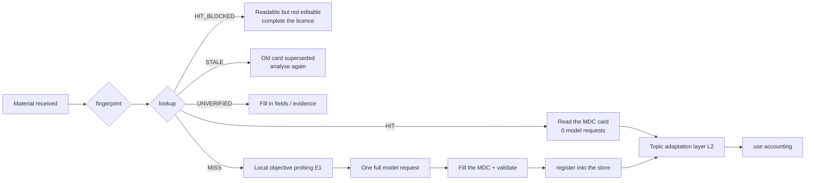

# Cache Reuse Protocol and Token Savings

> Category: Material memory | Topic: Hit/stale decisions, the write-it-all-at-once strategy, token estimation and accounting, concurrency and privacy | Compiled: 2026-11-10 | Applies to: Every step that calls a video model to understand material, and every reuse of the same material across sessions and topics

> ⚠️ This volume is a reference for engineering workflows and **does not constitute legal advice**. Cached content may include faces, locations, and licensing information, and must be managed under `../05-copyright/04` and your internal data policy.

---

## 1. Core state machine

`material_cache.py lookup` returns one of five states for each item of material, and **the operator must act according to this table**:

| State | Condition | Action |
| --- | --- | --- |
| `HIT` | `content_hash` matches, the card is `status: active`, and `rights_status != blocked` | **Do not call the video model**; read `cards/<MID>.yaml` directly; write one `use` record |
| `HIT_BLOCKED` | The card hits but `rights_status` is `blocked/unknown`, or the licence has expired | The description may be read for discussion, but **must not enter a timeline**; prompt for the missing licence |
| `STALE` | `content_hash` does not match the card (material modified or replaced) | Demote the old card to `superseded`; re-probe locally + one model request + new card |
| `UNVERIFIED` | A card exists but `validate` did not pass, or `status: unverified` | Fill in the missing fields and evidence first; it must not be used as a trusted description |
| `MISS` | Nothing registered at all | Local probing → **one** full model request → fill the card → `register` |



**The crux**: there is no branch between `HIT` and `MISS` called "just ask the model to confirm". The user is here to save tokens, and any "while we're at it, let the model take another look" breaks the loop.

---

## 2. Cache key: content-addressed, not path-addressed

| Item | Approach | Rationale |
| --- | --- | --- |
| Primary identity | SHA-256 (read in chunks of 64 KiB) | Path-independent: moving or renaming a file still hits; content changes invalidate automatically |
| Default `sampled` mode | Hash `size_bytes` + the first 2 MiB + the middle 2 MiB + the last 2 MiB | Multi-GB material need not be read end to end; a 3 GB file measures in the low tens of milliseconds |
| `full` mode | SHA-256 over the whole file | For projects with a high consistency risk (legal forensics, delivery masters, paid stock); slower, but with no blind spots |
| Additional checks | `size_bytes` + ffprobe `duration / vcodec / resolution` | Not part of the primary hash, but written to `index.csv` so anomalies are easy to spot by hand |
| Segments | `sha256(content_hash + start + end)[:12]`, with `parent_mid` | Different excerpts of the same material do not overwrite one another |

**Known limitation (you need to know this)**: `sampled` covers only 6 MiB plus the file size. If an edit falls in an unsampled region and the byte count stays the same, it can in theory slip through, producing a `HIT` against a description that is already out of date. Mitigations:

1. For material with `rights_status: cleared` that will reach delivery, register with `--full`;
2. Run `verify` before every delivery (it can be batched), or add it as a step after `scripts/qc_scan.sh`;
3. When material is re-exported or transcoded, actively `register` the new file instead of carrying the old one forward;
4. Record `hash_mode` in the card, so that downstream readers treat key conclusions with a little caution when they see `sampled`.

A corrupted or unparseable card is always treated as `MISS` and logged; bad data must never block the pipeline. This is the standard degradation strategy for content-hash caching.

---

## 3. Invalidation conditions (each one checkable)

| # | Trigger | Handling | Re-request the model? |
| --- | --- | --- | --- |
| 1 | The file content hash changes | New `MID`; the old card is kept as `superseded` | **Yes** (new material) |
| 2 | Trimming / transcoding / watermarking produces a new file | Treat as new material, linked by `parent_mid` | Usually no — read the parent card first and fill in only the differing segment |
| 3 | A description is disproved by a human | Produce `card_version+1` and write `corrections` | No — check against local frames first |
| 4 | `mdc-v1` → `mdc-v2` schema upgrade | Batch `validate`, fill in the missing fields | No (unless a new dimension requires looking at the picture) |
| 5 | Model version upgrade | **Not invalidated automatically**; recompute only if spot checks show the description quality has dropped | Depends on the spot-check result |
| 6 | Licence expiry / withdrawal | `rights_status: blocked` + audit log; **do not delete the card** | No |
| 7 | A privacy review requires faces or plates to be removed | Rewrite de-identified as `v+1`; seal the old version | No |
| 8 | The whole cache directory is corrupted | Rebuild as `MISS`, keeping the `usage.csv` statistics | Yes |

Rule 5 is deliberate: a model upgrade does not make old descriptions obsolete. Otherwise every model change would mean re-watching the entire library, and the savings would fall to zero.

---

## 4. The "write it all at once" request strategy

On a MISS, only **one** video-understanding request is permitted, so the prompt has to ask for everything in that single pass. Key points (the full copy-ready text is in `templates/model-analysis-prompt.md`):

| Requirement | How to do it |
| --- | --- |
| Lead with objective facts | Attach the ffprobe specs, cut-point table, frame contact sheets, and loudness as context, so the model does not have to "guess" the specs |
| Structured output | Ask for YAML in the four groups `content / where / style / usability`, with field names matching `mdc-v1` |
| Timecodes mandatory | Every event, every piece of on-screen text, and every quality defect carries `MM:SS.mmm` |
| Separate fact from inference | Mark every line `evidence: E1/E2/E3/E4`; `E3` must include "basis + falsification condition" |
| No guessing of place names or identities | State explicitly: "without in-frame text or a shooting record, `place_name: null`" |
| No topic framing | State explicitly: "the output must not contain topic names, project names, or usage recommendations"; usage tags may only be the neutral `affordances` |
| Cheaper handling of long material | The vendor recommends agentic mode or a custom FPS for long video; static mode defaults to 1 FPS, and long material may set `fps < 1` (**static mode only**), but fast motion will lose detail and must be cross-checked with frame extraction |
| Verify the result | Spot-check ≥3 timecode anchors against the original; model timestamps commonly show "the summary is right, but the exact moment is off" |

**The only legitimate path to a supplementary request**: if a field really is missing afterwards and it affects the edit, proceed in order: ① local frame extraction / ASR / ffprobe; ② **one** targeted follow-up request against the original video; ③ write the result back into the card and append `corrections` with a `reason`. Anything that amounts to "watch the whole thing again for the new topic" is not legitimate.

Vendor-side optimisations stack with this volume: the official documentation recommends the Files API (large files, reuse across requests) and context caching (repeated analysis of long video; explicit caches have a TTL, one hour by default; implicit caching has a minimum input-token threshold of 2048/4096) for "asking multiple questions about the same video". But these mechanisms **still bill tokens on every request**, and Files API uploads expire. This volume's cache turns the *description* into a static file, after which the number of requests is zero. The two can be combined: use the Files API plus context caching for that one full analysis, then read the local card forever after.

---

## 5. Token estimation and accounting

### 5.1 Basis

Google's official static video processing: 1 FPS by default; at low `media_resolution` each frame costs **66 tokens** plus **32 tokens/s** of audio ≈ **100 tokens per second of video**; at high resolution each frame costs **258 tokens** plus 32 ≈ **300 tokens per second**. Firebase AI Logic's documentation gives a different basis of **263 tokens/s (video) and 32 tokens/s (audio)** — the scope and version differ, so **mark it TO VERIFY** and never mix the two.

Estimation formula:

```
est_input_tokens = ceil(duration_s × rate)
rate = 100  # low-resolution static, default
      = 300  # high-resolution static
saved_tokens   = Σ( est_input_tokens of HIT events )
hit_rate       = HIT / (HIT + MISS)
effective_cost = 1 / (HIT + MISS)   # average model requests per topic
```

**This estimates video input tokens only.** It excludes prompt, output, and reasoning tokens and vendor cache discounts; real usage comes from the response's `usage_metadata` (e.g. `cached_content_token_count`, `prompt_token_count`). The tool accepts `--tokens <measured value>` and writes it to `actual_tokens`.

### 5.2 The payoff in one table

| Material | Duration | Default rate | Estimate per run | Adopted by 4 topics (no cache) | With cache | Saving |
| --- | --- | --- | --- | --- | --- | --- |
| Talking-head clip | 60 s | 100 tok/s | 6,000 | 24,000 | 6,000 | 75% |
| Product B-roll | 180 s | 100 tok/s | 18,000 | 72,000 | 18,000 | 75% |
| Long interview material | 1,200 s | 100 tok/s | 120,000 | 480,000 | 120,000 | 75% |
| The same, high resolution | 1,200 s | 300 tok/s | 360,000 | 1,440,000 | 360,000 | 75% |

In general: when material is reused by `N` topics, the saving is `1 − 1/N` (video input only). **The larger N is, the better the deal** — which is exactly the "one piece of material adopted by many topics" scenario.

### 5.3 Accounting fields

`cache/usage.csv`, one row per event:

```
ts,event,mid,theme,hash_mode,duration_s,est_tokens,actual_tokens,model,note
2026-11-10T15:20:00,MISS,MID-9f3c…,-,sampled,180,18000,,<model name>,first full analysis
2026-11-10T15:26:00,HIT,MID-9f3c…,T-2026-autumn-nostalgia,sampled,180,18000,,-,read the card directly; no model request
2026-11-10T15:31:00,HIT,MID-9f3c…,T-2026-climate-science,sampled,180,18000,,-,read the card directly; no model request
```

`stats` reports: number of items, number of topics, HIT/MISS counts, hit rate, estimated tokens saved, estimated average requests, a top-topic ranking, and the number of `blocked` items. **Every figure is labelled "estimated"**, so it is never mistaken for an invoice.

---

## 6. Concurrency, idempotency, and reliability

| Scenario | Handling |
| --- | --- |
| Two jobs `register` the same material at once | A simple exclusive lock file plus atomic writes (temp file, then `os.replace`); the second job sees the entry already exists and switches to `HIT` |
| The same topic calls `use` repeatedly | De-duplicated on `(mid, theme, clip, ts)`; repeated calls do not double-count |
| A card write fails halfway | The temp file is deleted on failure; a half-written card is never left behind; `index.csv` is updated last |
| Cache file corrupted / JSON parse failure | Degrade to `MISS` and write an audit entry; never raise an exception that interrupts the edit |
| Index and cards disagree | `verify` rescans everything and prints a diff list; a human decides whether the card or the index wins |
| The cache is deleted by accident | Only descriptions are lost, not the material; just analyse again. Back up `usage.csv` separately |
| kill switch | `cache_enabled: false` in `_config.json` at the cache root → `lookup` always returns `MISS` (forcing manual confirmation); used when investigating cache poisoning or description contamination |

The audit log `cache/audit.log` is **append-only**: one line per `register / use / verify / correction / blocked`, containing the time, event, MID, operator, and note. This matches the append-only convention in `../08-rsi/06`.

---

## 7. Privacy and security

- The cache **does not store the original video**, only the content hash, the path hint, the description text, and optionally frame thumbnails. Thumbnails can contain faces or licence plates just as easily, so treat them as sensitive material.
- `subjects` in a card never records real names or identity inferences; `geo_hint` is precise only to the extent needed, and exact GPS coordinates should not be stored.
- For material involving minors, ID documents, house numbers, or licence plates, `privacy_flags` must be non-empty; review against `../05-copyright/04` and `../06-delivery-qc/02` before publishing.
- Description text is read by every subsequent task, which makes it "one error, amplified for a long time": the V4–V6 checks and human spot checks are therefore not optional.
- Before syncing the cache directory across devices, confirm that internal data policy permits descriptions and thumbnails to be uploaded.

---

## 8. Command examples

```bash
PY="scripts/material_cache.py"
V="D:/footage/sunset-beach.mp4"

# Identity and specs (costs no tokens)
python "$PY" fingerprint "$V" --json

# The first step before any analysis
python "$PY" lookup "$V"

# On MISS: local objective probing
bash "scripts/reference_probe.sh" "$V" /tmp/probe_hb

# One full model request → fill the card → validate → register
python "$PY" validate /tmp/MID-9f3c.yaml
python "$PY" register "$V" --card /tmp/MID-9f3c.yaml --model "<model name>" --tokens 18000

# For material with a high consistency risk, switch to whole-file hashing
python "$PY" register "$V" --card /tmp/MID-9f3c.yaml --full

# Reuse from later topics
python "$PY" use "$V" --theme "T-2026-autumn-nostalgia" --clip "00:00:03-00:00:08" --note "opening B-roll"
python "$PY" use "$V" --theme "T-2026-climate-science" --clip "00:00:12-00:00:19" --note "cloud-layer illustration"

# Pre-delivery health check and statistics
python "$PY" verify "$V"
python "$PY" themes "$V"
python "$PY" stats
```

---

## 9. Common errors and troubleshooting

| Error | Consequence | Correct approach |
| --- | --- | --- |
| Using the file path as the cache key | A moved file triggers a fresh model request | Use the content hash; the path is only an alias |
| "Let the model confirm" after a hit | Savings fall to zero, and the answer may contradict the card | Read the card only; if you disagree, go through local frames or `verify` |
| Topic judgements written into the MDC | Descriptions are contaminated when the topic changes | Write them into the L2 topic adaptation layer |
| `sampled` hashes used for forensic-grade work | Changes in unsampled regions can be missed | `--full`, plus `verify` before delivery |
| Estimated tokens treated as an invoice | Finance and capacity planning drift | Overwrite `actual_tokens` with measured `usage_metadata` values |
| Recomputing the whole library after a model upgrade | Costs explode and historical descriptions become incomparable | Spot-check quality and recompute only where it has regressed |
| Deleting a card when the licence expires | You can no longer trace "why it was used at the time" | Mark `blocked` and keep an append-only log |

---

## 10. Quick reference

- [ ] Run `lookup` before every analysis; on `HIT`, read only
- [ ] `MISS` triggers exactly one full model request, and the prompt asks for everything at once
- [ ] Objective specs are gathered locally first (ffprobe / probe scripts); never spend model tokens on them
- [ ] `sampled` for ordinary material; `--full` for forensic work and delivery masters
- [ ] Write a `use` record for every reuse; label `stats` output as estimated
- [ ] `verify` before delivery; any `blocked/unknown` rights status is a hard stop
- [ ] The audit log is append-only; back up the cache directory and `usage.csv` regularly
- [ ] Privacy items reviewed, and thumbnails treated as sensitive material

---

## References

- Google AI for Developers, "Video understanding" (1 FPS sampling, 66/258 tokens per frame, 32 tokens/s of audio, roughly 100/300 tokens per second, Files API recommended for repeated reuse, custom FPS and clipping available in static mode only): https://ai.google.dev/gemini-api/docs/video-understanding
- Google, "Context caching" (implicit caching minimum of 2048/4096 tokens, explicit cache TTL of one hour by default, repeated analysis of long video as the typical case): https://ai.google.dev/gemini-api/docs/caching
- Firebase AI Logic, "Count tokens for Gemini models" (an alternative basis of 263 tokens/s): https://firebase.google.com/docs/ai-logic/count-tokens
- Content-Hash File Cache Pattern (chunked SHA-256, path-independent, automatic invalidation, corrupted entries degraded to misses, service-layer wrapper): https://lobehub.com/ru/skills/sehoon787-my-claude-content-hash-cache-pattern
- Gemini Files API in practice (upload once, ask many times; tokens are still billed per call and uploaded files expire): https://ossaihub.com/code/gemini-multimodal-with-files-api
- This volume's `01`, `03`, `04`; `../08-rsi/01` (hard guardrails and append-only auditing), `scripts/qc_scan.sh`

Retrieved: 2026-11-10. Token rates, cache thresholds, TTLs, and file-retention periods are all **volatile information** and differ markedly between vendors and model versions; re-check the latest official documentation before use. The conflict between the `100/300 tok/s` and `263 tok/s` bases is recorded as TO VERIFY. The `sampled` hash, the `1−1/N` saving formula, and all accounting fields are conventions defined by this knowledge base.
