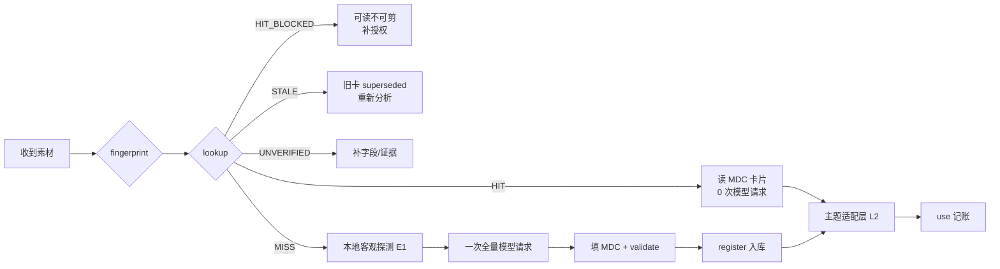

# 缓存复用协议与 Token 节省

> 分类：素材记忆 | 主题：命中/失效判定、一次写全策略、token 估算与记账、并发与隐私 | 整理日期：2026-11-10 | 适用：所有调用视频模型理解素材的环节，以及跨会话、跨主题复用同一素材

> ⚠️ 本卷为工程流程参考，**不构成法律意见**；缓存内容可能含人脸、地点与授权信息，须按 `../05-版权法规/04` 与内部数据政策管理。

---

## 一、核心状态机

`material_cache.py lookup` 对每个素材返回五种状态之一，**执行者必须按表行动**：

| 状态 | 判定条件 | 动作 |
| --- | --- | --- |
| `HIT` | `content_hash` 一致，且卡片 `status: active`，且 `rights_status != blocked` | **禁止调用视频模型**；直接读 `cards/<MID>.yaml`；写一条 `use` 记录 |
| `HIT_BLOCKED` | 卡片命中但 `rights_status` 为 `blocked/unknown` 或授权已过期 | 可读描述用于讨论，但**禁止进入时间线**；提示补齐授权 |
| `STALE` | `content_hash` 与卡片不符（素材被改/换版本） | 旧卡转 `superseded`；重新本地探测 + 一次模型请求 + 新卡 |
| `UNVERIFIED` | 卡片存在但 `validate` 未通过或 `status: unverified` | 先补齐字段与证据，不得当作可信描述使用 |
| `MISS` | 无任何登记 | 本地探测 → **一次**全量模型请求 → 填卡 → `register` |



**关键**：`HIT` 与 `MISS` 之间不存在「再问模型确认一下」这个分支。用户要的是省 token，任何「顺便再让模型看一眼」都会把闭环打破。

---

## 二、缓存键：内容寻址而非路径寻址

| 项 | 做法 | 理由 |
| --- | --- | --- |
| 主身份 | SHA-256（分块读取，64 KiB 块） | 路径无关：文件移动/重命名仍命中；内容改动自动失效 |
| 默认 `sampled` 模式 | 哈希 `size_bytes` + 头部 2 MiB + 中部 2 MiB + 尾部 2 MiB | 数 GB 素材不用全盘读；实测 3 GB 文件约十几毫秒量级 |
| `full` 模式 | 全文件 SHA-256 | 高一致风险项目（法律取证、交付母版、付费素材）用；慢但无盲区 |
| 附加校验 | `size_bytes` + ffprobe `duration / vcodec / resolution` | 不参与主哈希，但写入 `index.csv` 便于人工发现异常 |
| 片段 | `sha256(content_hash + start + end)[:12]`，带 `parent_mid` | 同一素材不同截取段不互相覆盖 |

**已知局限（必须知道）**：`sampled` 只覆盖 6 MiB 与文件大小；若修改只发生在未采样区且字节数不变，理论上会漏检，得到 `HIT` 而描述已过期。缓解措施：

1. 对 `rights_status: cleared` 且要进入交付的素材，登记时用 `--full`；
2. 每次交付前跑一次 `verify`（可批量），或在 `scripts/qc_scan.sh` 之后加一步；
3. 素材被重新导出/转码时，主动 `register` 新文件而非沿用；
4. 卡片里写清 `hash_mode`，下游看到 `sampled` 时对关键结论保持一分警惕。

工具把损坏/无法解析的卡片一律按 `MISS` 处理并记日志，不让坏数据阻塞流程——这是内容哈希缓存模式的常见降级做法。

---

## 三、失效条件（逐条可检查）

| # | 触发 | 处理 | 是否重新请求模型 |
| --- | --- | --- | --- |
| 1 | 文件内容哈希变化 | 新 `MID`，旧卡 `superseded` 保留 | **是**（新素材） |
| 2 | 裁剪/转码/加水印产出新文件 | 视为新素材，`parent_mid` 关联 | 通常否，先读父卡 + 只补差异段 |
| 3 | 描述被人工证伪 | 生成 `card_version+1`，写 `corrections` | 否，优先本地抽帧核对 |
| 4 | `mdc-v1` → `mdc-v2` schema 升级 | 批量 `validate`，缺字段补齐 | 否（除非新增维度必须看画面） |
| 5 | 模型版本升级 | **不自动失效**；仅当抽查发现描述质量下降才重算 | 视抽查结果 |
| 6 | 授权到期 / 撤回 | `rights_status: blocked` + 审计日志，**不删卡** | 否 |
| 7 | 隐私复核要求删除人脸/车牌信息 | 脱敏重写 `v+1`，旧版封存 | 否 |
| 8 | 缓存目录整体损坏 | 按 `MISS` 重建，保留 `usage.csv` 统计 | 是 |

第 5 条是刻意设计：模型升级不等于旧描述作废，否则每次换模型都要把全库重看一遍，节省归零。

---

## 四、「一次写全」的请求策略

MISS 时只允许**一次**视频理解请求，因此提示词必须一次问全。要点（完整可复制文本见 `模板/模型分析提示词.md`）：

| 要求 | 具体做法 |
| --- | --- |
| 先给客观事实 | 把 ffprobe 规格、切点表、抽帧拼图、响度一起作为上下文附上，模型不必再「猜」规格 |
| 输出结构化 | 要求按 `content / where / style / usability` 四组返回 YAML，字段名与 `mdc-v1` 一致 |
| 强制时间码 | 每个事件、每处画面内文字、每个质量瑕疵都带 `MM:SS.mmm` |
| 强制区分事实与推断 | 每条标 `evidence: E1/E2/E3/E4`；`E3` 必须附「依据 + 可证伪条件」 |
| 禁止猜测地名与身份 | 明确写「无画面内文字或拍摄记录则 `place_name: null`」 |
| 禁止主题化 | 明确写「输出中不得出现具体主题名、项目名、用途建议」，用途标签只能写中立的 `affordances` |
| 长素材降本 | 官方建议长视频用 Agentic 模式或自定义 FPS；静态模式默认 1 FPS，长素材可设 `fps < 1`（**仅静态模式支持**），但快速运动会漏细节，须交叉抽帧验证 |
| 结果校验 | 抽查 ≥3 个时间码锚点与原片比对；模型给的时间戳常见「总结合理但具体时刻不准」 |

**补充请求的唯一合法路径**：若事后发现某字段确实缺失且影响剪辑，按优先序 ①本地抽帧/ASR/ffprobe ②对原视频做**一次**针对性补充请求 ③把补充结果写回卡片并追加 `corrections` 与 `reason`。任何「为新主题再整体看一遍」都不合法。

厂商侧优化与本卷叠加：官方文档明确「同一视频多次提问」推荐 Files API（大文件、跨请求复用）与上下文缓存（长视频多次分析，显式缓存有 TTL，默认 1 小时；隐式缓存最低输入 token 门槛 2048/4096）。但这些机制**每次请求仍会产生 token 计费**，且 Files API 文件有保存期限；本卷缓存是把「描述」变成静态文件，之后请求数为 0。两者可同时用：第一次用 Files API + 上下文缓存做那次全量分析，之后永久读本地卡。

---

## 五、Token 估算与记账

### 5.1 口径

Google 官方静态视频处理：默认 1 FPS，低 `media_resolution` 每帧 **66 token** + 音频 **32 token/秒** ≈ **100 token/秒视频**；高分辨率每帧 **258 token** + 32 ≈ **300 token/秒**。Firebase AI Logic 文档另给 **263 token/秒（视频）与 32 token/秒（音频）** 的口径——统计范围与版本不同，**标「待核实」**，不要混用。

估算公式：

```
est_input_tokens = ceil(duration_s × rate)
rate = 100  # 低分辨率静态，默认
      = 300  # 高分辨率静态
saved_tokens   = Σ( HIT 事件的 est_input_tokens )
hit_rate       = HIT / (HIT + MISS)
effective_cost = 1 / (HIT + MISS)   # 平均每个主题的模型请求次数
```

**这只是视频输入 token 的估算**，不含提示词、输出、推理 token 与厂商缓存折扣；真实用量以响应的 `usage_metadata` 为准（如 `cached_content_token_count`、`prompt_token_count`），工具支持 `--tokens <实测值>` 写入 `actual_tokens`。

### 5.2 一张表看懂收益

| 素材 | 时长 | 默认速率 | 单次估算 | 被 4 个主题采用（无缓存） | 有缓存 | 节省 |
| --- | --- | --- | --- | --- | --- | --- |
| 口播片段 | 60 s | 100 tok/s | 6,000 | 24,000 | 6,000 | 75% |
| 产品 B-roll | 180 s | 100 tok/s | 18,000 | 72,000 | 18,000 | 75% |
| 访谈长素材 | 1,200 s | 100 tok/s | 120,000 | 480,000 | 120,000 | 75% |
| 同上，高分辨率 | 1,200 s | 300 tok/s | 360,000 | 1,440,000 | 360,000 | 75% |

一般式：被 `N` 个主题复用，节省比例 `1 − 1/N`（只算视频输入）。**N 越大越划算**，这正是「一个素材被很多主题采纳」的场景。

### 5.3 记账字段

`缓存库/usage.csv` 每行一条：

```
ts,event,mid,theme,hash_mode,duration_s,est_tokens,actual_tokens,model,note
2026-11-10T15:20:00,MISS,MID-9f3c…,-,sampled,180,18000,,<模型名>,首次全量分析
2026-11-10T15:26:00,HIT,MID-9f3c…,T-2026-秋日怀旧,sampled,180,18000,,-,直接读卡;未请求模型
2026-11-10T15:31:00,HIT,MID-9f3c…,T-2026-气候科普,sampled,180,18000,,-,直接读卡;未请求模型
```

`stats` 输出：素材数、主题数、HIT/MISS 次数、命中率、估算节省 token、估算平均请求次数、按主题 Top 榜、被 `blocked` 的素材数。**所有数字标注「估算」**，避免被当成账单。

---

## 六、并发、幂等与可靠性

| 场景 | 处理 |
| --- | --- |
| 两个任务同时 `register` 同一素材 | 简易独占锁文件 + 原子写（临时文件 `os.replace`）；后者发现已存在则改为 `HIT` |
| 同一主题重复 `use` | 以 `(mid, theme, clip, ts)` 去重；重复调用不重复计数 |
| 卡片写入中途失败 | 临时文件失败即删，绝不留下半张卡；`index.csv` 最后更新 |
| 缓存文件损坏 / JSON 解析失败 | 按 `MISS` 降级并写审计日志，不抛异常中断剪辑 |
| 索引与卡片不一致 | `verify` 全量重扫，输出差异清单，人工决定以卡片还是索引为准 |
| 缓存被误删 | 只丢描述、不丢素材；重新分析即可；`usage.csv` 建议单独备份 |
| kill switch | 缓存根目录 `_config.json` 中 `cache_enabled: false` → `lookup` 恒返回 `MISS`（强制走人工确认），用于排查缓存投毒或描述污染 |

审计日志 `缓存库/audit.log` **只追加**：每次 `register / use / verify / 纠错 / blocked` 一行，含时间、事件、MID、操作者、说明。与 `../08-RSI自进化/06` 的只追加约定一致。

---

## 七、隐私与安全

- 缓存**不保存原视频**，只保存内容哈希、路径提示、描述文本与可选抽帧缩略图；缩略图同样可能含人脸/车牌，按敏感素材管理。
- 卡片中 `subjects` 不写真实姓名与身份推断；`geo_hint` 精确到够用即可，避免存精确 GPS。
- 含未成年人、证件、门牌、车牌的素材，`privacy_flags` 必须非空；发布前按 `../05-版权法规/04` 与 `../06-成片审查/02` 复核。
- 描述文本会被后续每次任务读取，相当于「一次错误、长期放大」：因此 V4–V6 校验与人工抽查不可省。
- 跨设备同步缓存目录时，先确认内部数据政策是否允许把描述与缩略图上传。

---

## 八、命令示例

```bash
PY="scripts/material_cache.py"
V="D:/素材/海边日落.mp4"

# 身份与规格（不花 token）
python "$PY" fingerprint "$V" --json

# 任何分析前的第一步
python "$PY" lookup "$V"

# MISS 时：本地客观探测
bash "scripts/reference_probe.sh" "$V" /tmp/probe_hb

# 一次全量模型请求 → 填卡 → 校验 → 登记
python "$PY" validate /tmp/MID-9f3c.yaml
python "$PY" register "$V" --card /tmp/MID-9f3c.yaml --model "<模型名>" --tokens 18000

# 高一致风险素材改用全文件哈希
python "$PY" register "$V" --card /tmp/MID-9f3c.yaml --full

# 后续主题复用
python "$PY" use "$V" --theme "T-2026-秋日怀旧" --clip "00:00:03-00:00:08" --note "开场空镜"
python "$PY" use "$V" --theme "T-2026-气候科普" --clip "00:00:12-00:00:19" --note "云层示意"

# 交付前体检与统计
python "$PY" verify "$V"
python "$PY" themes "$V"
python "$PY" stats
```

---

## 九、常见错误与排查

| 错误 | 后果 | 正确做法 |
| --- | --- | --- |
| 用文件路径当缓存键 | 文件一移动就重复请求模型 | 用内容哈希，路径只作别名 |
| 命中后又「让模型确认一下」 | 节省归零，且可能得到与卡片矛盾的描述 | 只读卡；有异议走本地抽帧或 `verify` |
| 把主题判断写进 MDC | 换主题时描述污染 | 写 L2 主题适配层 |
| 用 `sampled` 哈希做取证级用途 | 未采样区改动可能漏检 | `--full` + 交付前 `verify` |
| 把估算 token 当账单 | 财务与容量规划失真 | 用 `usage_metadata` 实测值覆盖 `actual_tokens` |
| 模型升级就全库重算 | 成本暴增、历史描述不可比 | 抽查质量，仅劣化时重算 |
| 授权到期删卡 | 无法追溯「当时为什么用了」 | 标 `blocked` + 只追加日志 |

---

## 十、速查清单

- [ ] 每次分析前先 `lookup`，`HIT` 即只读
- [ ] `MISS` 只发生一次全量模型请求，提示词一次问全
- [ ] 客观规格先本地取（ffprobe / probe 脚本），不浪费模型 token
- [ ] `sampled` 用于常规素材，取证/交付母版用 `--full`
- [ ] 每次复用写 `use`，`stats` 输出标注为估算
- [ ] 交付前 `verify`，授权状态为 `blocked/unknown` 一律阻断
- [ ] 审计日志只追加，缓存目录与 `usage.csv` 定期备份
- [ ] 隐私项已复核，缩略图按敏感素材管理

---

## 参考来源

- Google AI for Developers《Video understanding》（1 FPS 采样、66/258 token 每帧、32 token/秒音频、约 100/300 token 每秒、Files API 推荐用于多次复用、自定义 FPS 与 clipping 仅静态模式）：https://ai.google.dev/gemini-api/docs/video-understanding
- Google《Context caching》（隐式缓存最低 token 门槛 2048/4096、显式缓存 TTL 默认 1 小时、重复分析长视频为典型场景）：https://ai.google.dev/gemini-api/docs/caching
- Firebase AI Logic《统计 Gemini 模型的词元数》（263 token/秒另一口径）：https://firebase.google.com/docs/ai-logic/count-tokens
- Content-Hash File Cache Pattern（分块 SHA-256、路径无关、自动失效、损坏按未命中降级、服务层包装）：https://lobehub.com/ru/skills/sehoon787-my-claude-content-hash-cache-pattern
- Gemini Files API 实践（上传一次多次提问；token 仍按次计费、文件有保存期限）：https://ossaihub.com/code/gemini-multimodal-with-files-api
- 本卷 `01`、`03`、`04`；`../08-RSI自进化/01`（硬护栏与只追加审计）、`scripts/qc_scan.sh`

检索日期：2026-11-10。token 速率、缓存门槛、TTL、文件保存期限均为**易变信息**，各厂商与各模型版本差异明显，用前回查官方最新文档；`100/300 tok/s` 与 `263 tok/s` 口径冲突已列「待核实」。`sampled` 哈希、`1−1/N` 节省式与全部记账字段为本知识库自定义约定。
